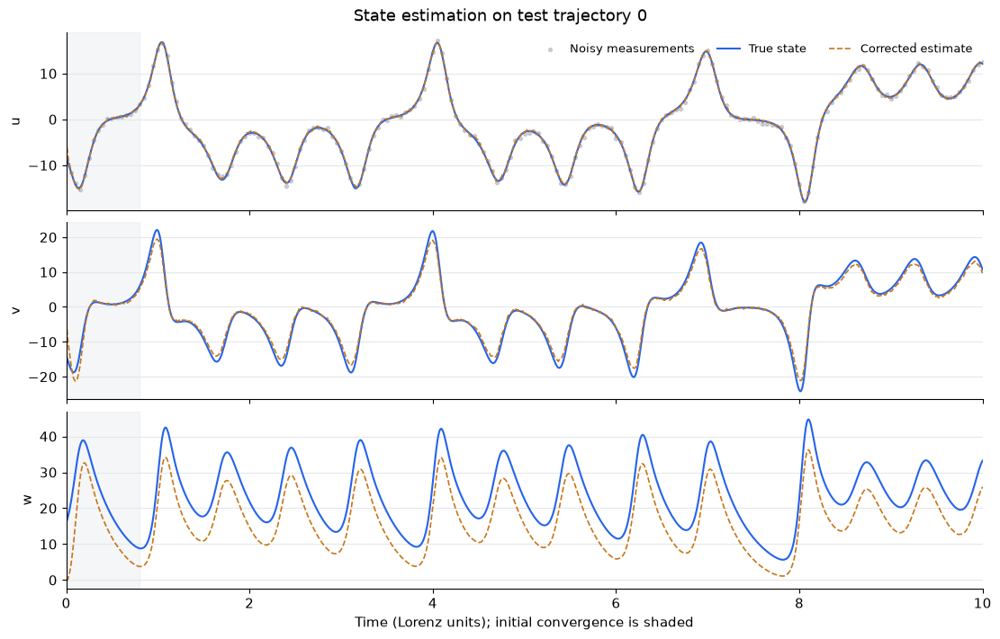
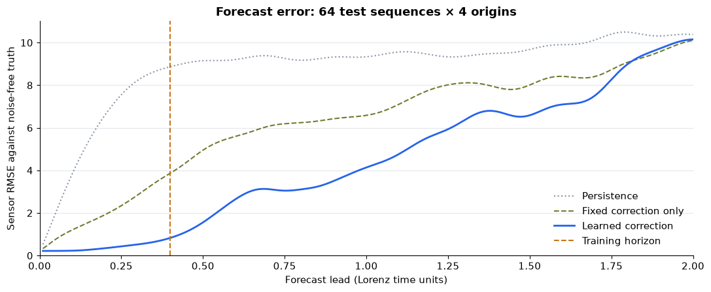

# State Forecast

State Forecast fits dynamical equations to noisy, partially observed time
series. The joint trajectory-fitting examples estimate a shared set of dynamics
coefficients and a separate latent state trajectory for each training sequence.
The fitted equations then support state estimation and forecasting from new
measurement histories.

## Joint trajectory fitting

Each example specifies a candidate rate model, an observation operator $H$,
and a sampling interval. Sparse Gauss–Newton fits all latent states $x_{i,k}$
and a single coefficient vector $\theta$ by minimizing weighted sensor
residuals and one-step transition defects across training trajectories.

$$
\sum_i\sum_{k=0}^{T-1}\left\|R^{-1/2}(Hx_{i,k}-y_{i,k})\right\|^2
+
\sum_i\sum_{k=0}^{T-2}\left\|Q^{-1/2}
\left(x_{i,k+1}-\Phi_\theta(x_{i,k})\right)\right\|^2 .
$$

Each training trajectory contains $T$ samples, with measurements $y_{i,k}$.
The map $\Phi_\theta$ advances the candidate dynamics by one RK4 step. The
diagonal matrices $R$ and $Q$ contain squared measurement and transition-defect
scales. The examples use zero coefficient regularization and reserve simulated
state truth for evaluation.

1. Fit the shared coefficients and training trajectories from several initial
   coefficient vectors.
2. Select the coefficient fit and history length by forecast RMSE on future
   validation readings.
3. Freeze the coefficients and fit each held-out history through its forecast
   origin. Use the final fitted state to initialize a rollout with the learned
   dynamics.

### Run the notebooks

Use Python 3.11 or newer and launch JupyterLab from the repository root.

```bash
python -m pip install -e ".[notebooks]"
python -m jupyter lab
```

Open either notebook from the `notebooks/` directory in JupyterLab. Both
generate seeded synthetic data, run on CPU, and include saved
results. Endpoint RMSE below pools 13 forecast origins on each of 48 held-out
trajectories.

| Notebook | Measured coordinates | Hidden coordinate | Selected history | Hidden-state RMSE |
| --- | --- | --- | ---: | ---: |
| [Pendulum](notebooks/pendulum_joint_fit.ipynb) | Angle | Angular velocity | 31 readings (1.50 s) | 0.04733 rad/s |
| [Lorenz](notebooks/lorenz_joint_fit.ipynb) | `u`, `v` | `w` | 81 readings (0.80 time units) | 0.07905 |

The pendulum fixes the kinematic equation and estimates four acceleration
coefficients. The Lorenz fit fixes the quadratic interactions and recovers
all five fitted coefficients within 0.32% of their simulator values. These
results characterize the supplied model families and sensor configurations.
The notebooks share a [sparse least-squares solver](examples/trajectory_fit.py).

## PyTorch forecasting library

The PyTorch API pairs a differentiable dynamics model with a learned
measurement corrector for online state estimation. It supports arbitrary
state dimensions, fixed linear observations, continuous or discrete dynamics,
and optional state constraints. The [Lorenz training notebook](notebooks/lorenz.ipynb)
illustrates the forecast-loss workflow.



*State reconstruction from one noisy sensor (`u`) on held-out trajectory 0.
The inferred `w` remains biased, illustrating that accurate sensor estimates
alone do not establish full state recovery. Shading marks initial convergence.*

### Library installation

Requires Python 3.11 or newer. The library depends only on PyTorch.

```bash
python -m venv .venv
source .venv/bin/activate
python -m pip install -e .
```

For the examples and tests, install `".[examples,test]"` instead. For the notebook,
install `".[notebooks,test]"`. To use CPU-only PyTorch, install it first from the
[PyTorch CPU index](https://download.pytorch.org/whl/cpu).

### Train and forecast

Supply a PyTorch module that returns a state rate and an observation matrix whose
rows map state components to sensors:

```python
import torch
from torch import nn
from state_forecast import JointEstimator, ODEDynamics, TrainingConfig, fit

rate = nn.Linear(4, 4, bias=False)
dynamics = ODEDynamics(rate, dt=0.01, integrator="rk4")
model = JointEstimator(dynamics, observation=torch.eye(4)[:2])

# Measurements have shape [independent sequences, times, sensors].
# Each sequence must contain every forecast origin and its future targets.
result = fit(
    model,
    train_measurements,
    validation_measurements,
    TrainingConfig(origins=(60, 80, 100), horizon=40, updates=1000),
)
```

For discrete dynamics, pass the transition module directly to `JointEstimator`.
`ODEDynamics` supports Euler and RK4 integration. Fixed correction scales can
condition the neural corrector without changing the physical loss; an optional
`state_projection` applies differentiable constraints after correction.

Training minimizes future measurement MSE using measurement sequences only.
Multiple forecast origins share a causal history pass; gradients
flow through the entire history. Current disagreement is logged as a diagnostic
and does not enter training or checkpoint selection: matching an already
assimilated noisy measurement can discourage denoising and bias learned dynamics.
`model.loss` returns `(objective, future_MSE, current_MSE)`, with
`objective == future_MSE`. The `current_weight` argument and configuration field
are no longer supported.

`fit` selects and restores the model with the lowest validation future MSE,
then freezes its parameters by default. Call `model.requires_grad_(True)`
before a subsequent training phase, which starts a fresh Adam optimizer.

For online inference, reset the posterior at the start of each independent sequence:

```python
posterior = None
with torch.no_grad():
    for measurement in arriving_measurements:
        posterior = model.assimilate(measurement, posterior)
        future_states = model.forecast(posterior, horizon=40)
        future_measurements = model.observe(future_states)
```

`model.filter(measurements)` processes a complete batch of histories. Save model
parameters using standard PyTorch state dictionaries; reconstruct the same dynamics,
observation matrix, correction scales, and architecture before loading.

### Lorenz walkthrough

```bash
python -m pip install -e ".[notebooks,test]"
python -m jupyter lab notebooks/lorenz.ipynb
```

The notebook trains from scratch and includes coefficient diagnostics, state
reconstruction, causal forecasts, and comparisons with persistence and a fixed
corrector. The committed notebook includes the completed one-sensor run, with
training logs, metrics, and six plots visible without executing any code. Only
`u` is measured; `v` and `w` are inferred. Set `SENSORS` to `1`, `2`, or `3` in
the notebook to choose the measured coordinates, then rerun training and the
following cells. Its two training phases each default to 800 updates.

Notebook outputs are kept in version control. Separate checkpoint, evaluation,
and preview files stay local and are excluded. Viewing the notebook requires no
checkpoint; resuming evaluation after a kernel restart requires a locally
generated checkpoint.

For command-line experiments and the model assumptions, see
[examples/README.md](examples/README.md). The Lorenz candidate family fixes its
quadratic interactions; useful sensor forecasts do not guarantee exact recovery
of an unmeasured coordinate or the true coefficients. Results from a single
synthetic seed do not establish robustness.



*Forecast error against noise-free `u`, aggregated over 64 test sequences and
four origins per sequence. The dashed vertical line marks the 0.4-unit training
horizon. Fixed correction uses the same learned dynamics with the neural
corrector disabled. Both figures come from the notebook's saved single-seed run.*

## Development

```bash
python -m pip install -e ".[examples,test]"
python -m pytest -q
```

Tests cover causality, full gradient flow, independent history resets, arbitrary
state dimensions, physical projection, both integrators, measurement-only
optimization, and checkpoint round trips. GitHub Actions runs the suite on
Python 3.11 and 3.12 and checks that the package builds.

To execute a short notebook check, including both training phases and all plots:

```bash
LORENZ_SENSORS=1 LORENZ_UPDATES=2 LORENZ_REFINEMENT_UPDATES=1 \
  python -m jupyter nbconvert --execute --to notebook \
  --output lorenz-smoke --output-dir /tmp notebooks/lorenz.ipynb
```

## Project structure

```text
state_forecast/       Reusable integration, estimation, and training library
examples/             Lorenz simulation, training, evaluation, and plotting
notebooks/lorenz.ipynb Training walkthrough with native Matplotlib plots
tests/                Library and example tests
```
