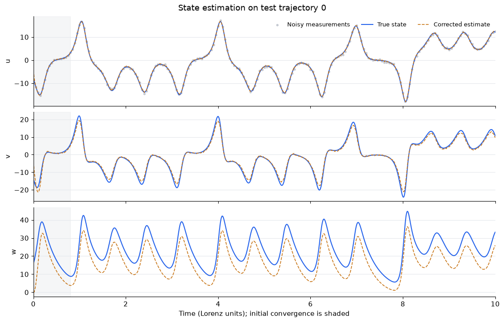
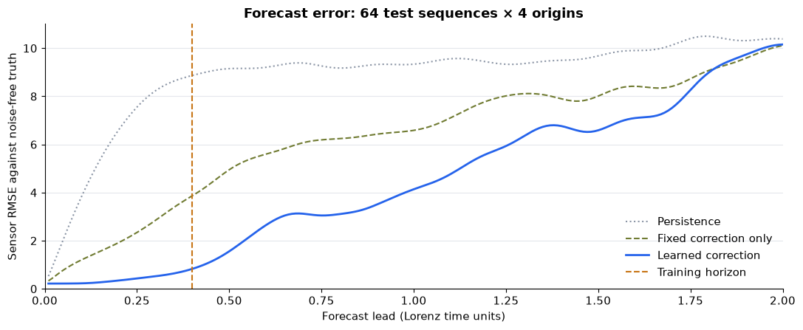

# State Forecast

Joint state estimation and dynamics learning from measurement sequences, built
with PyTorch. Train a differentiable dynamics model and a neural measurement
corrector together, then assimilate incoming observations and forecast forward.

The library supports arbitrary state dimensions, fixed linear observation
operators, continuous or discrete dynamics, and optional physical constraints.
The Lorenz example demonstrates the method with one, two, or three noisy sensors.



*State reconstruction from one noisy sensor (`u`) on held-out trajectory 0.
The inferred `w` remains biased, illustrating that accurate sensor estimates
alone do not establish full state recovery. Shading marks initial convergence.*

## Installation

Requires Python 3.11 or newer. The library depends only on PyTorch.

```bash
python -m venv .venv
source .venv/bin/activate
python -m pip install -e .
```

For the examples and tests, install `".[examples,test]"` instead. For the notebook,
install `".[notebooks,test]"`. To use CPU-only PyTorch, install it first from the
[PyTorch CPU index](https://download.pytorch.org/whl/cpu).

## Usage

Supply a PyTorch module that returns a state rate and an observation matrix whose
rows map state components to sensors:

```python
import torch
from torch import nn
from state_forecast import JointEstimator, ODEDynamics, TrainingConfig, fit

rate = nn.Linear(4, 4, bias=False)
dynamics = ODEDynamics(rate, dt=0.01, integrator="rk4")
model = JointEstimator(dynamics, observation=torch.eye(4)[:2])

# Measurements have shape [independent sequences, times, sensors].
# Each sequence must contain every forecast origin and its future targets.
result = fit(
    model,
    train_measurements,
    validation_measurements,
    TrainingConfig(origins=(60, 80, 100), horizon=40, updates=1000),
)
```

For discrete dynamics, pass the transition module directly to `JointEstimator`.
`ODEDynamics` supports Euler and RK4 integration. Fixed correction scales can
condition the neural corrector without changing the physical loss; an optional
`state_projection` applies differentiable constraints after correction.

Training minimizes `future_MSE + current_weight * current_MSE` using measurement
sequences only. Multiple forecast origins share a causal history pass; gradients
flow through the entire history. `fit` selects and restores the best validation
model, then freezes its parameters by default. Call `model.requires_grad_(True)`
before a subsequent training phase, which starts a fresh Adam optimizer.

For online inference, reset the posterior at the start of each independent sequence:

```python
posterior = None
with torch.no_grad():
    for measurement in arriving_measurements:
        posterior = model.assimilate(measurement, posterior)
        future_states = model.forecast(posterior, horizon=40)
        future_measurements = model.observe(future_states)
```

`model.filter(measurements)` processes a complete batch of histories. Save model
parameters using standard PyTorch state dictionaries; reconstruct the same dynamics,
observation matrix, correction scales, and architecture before loading.

## Lorenz walkthrough

```bash
python -m pip install -e ".[notebooks,test]"
python -m jupyter lab notebooks/lorenz.ipynb
```

The notebook trains from scratch and includes coefficient diagnostics, state
reconstruction, causal forecasts, and comparisons with persistence and a fixed
corrector. The committed notebook includes the completed one-sensor run, with
training logs, metrics, and six plots visible without executing any code. Only
`u` is measured; `v` and `w` are inferred. Set `SENSORS` to `1`, `2`, or `3` in
the notebook to choose the measured coordinates, then rerun training and the
following cells. Its two training phases each default to 800 updates.

Notebook outputs are kept in version control. Separate checkpoint, evaluation,
and preview files stay local and are excluded. Viewing the notebook requires no
checkpoint; resuming evaluation after a kernel restart requires a locally
generated checkpoint.

For command-line experiments and the model assumptions, see
[examples/README.md](examples/README.md). The Lorenz candidate family fixes its
quadratic interactions; useful sensor forecasts do not guarantee exact recovery
of an unmeasured coordinate or the true coefficients. Results from a single
synthetic seed do not establish robustness.



*Forecast error against noise-free `u`, aggregated over 64 test sequences and
four origins per sequence. The dashed vertical line marks the 0.4-unit training
horizon. Fixed correction uses the same learned dynamics with the neural
corrector disabled. Both figures come from the notebook's saved single-seed run.*

## Development

```bash
python -m pip install -e ".[examples,test]"
python -m pytest -q
```

Tests cover causality, full gradient flow, independent history resets, arbitrary
state dimensions, physical projection, both integrators, measurement-only
optimization, and checkpoint round trips. GitHub Actions runs the suite on
Python 3.11 and 3.12 and checks that the package builds.

To execute a short notebook check, including both training phases and all plots:

```bash
LORENZ_SENSORS=1 LORENZ_UPDATES=2 LORENZ_REFINEMENT_UPDATES=1 \
  python -m jupyter nbconvert --execute --to notebook \
  --output lorenz-smoke --output-dir /tmp notebooks/lorenz.ipynb
```

## Project structure

```text
state_forecast/       Reusable integration, estimation, and training library
examples/             Lorenz simulation, training, evaluation, and plotting
notebooks/lorenz.ipynb Training walkthrough with native Matplotlib plots
tests/                Library and example tests
```
